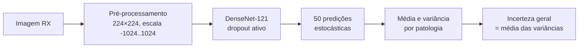

# 🎲 Incerteza em Radiografias de Tórax com Monte Carlo Dropout

> Iniciação Científica — UDESC · Ciência da Computação
> Estimativa de **incerteza epistêmica** em imagens de raio-X usando **Monte Carlo Dropout** sobre uma DenseNet-121 pré-treinada (`torchxrayvision`).


---

## 📌 Sobre

Este módulo complementa a análise feita com descritores clássicos (LBP/GLCM + Random Forest / Regressão Logística) com uma abordagem de **deep learning**: em vez de treinar um classificador novo, usamos uma rede já treinada em radiografias de tórax e medimos o quanto as suas predições **variam** quando o dropout é mantido ativo na inferência.

A base é a mesma do restante do projeto, dividida em três classes: **Saudavel**, **Doente** e **Incerto**. A pergunta é: *as imagens Incertas geram predições mais instáveis (maior incerteza) do que as imagens Saudáveis e Doentes?*

---

## 🔬 Como funciona

**Monte Carlo Dropout** consiste em manter o dropout ligado durante a inferência e passar a mesma imagem pela rede `N` vezes. Como cada passagem desliga neurônios diferentes, as saídas variam, e essa variação é usada como medida de incerteza.



### Modelo
- `torchxrayvision` · `DenseNet` com pesos `densenet121-res224-all`
- Dropout com `drop_rate = 0.2` ativado em todas as camadas `_DenseLayer`
- Camadas `BatchNorm2d` mantidas em modo `eval` (para não alterar estatísticas de normalização)

### Pré-processamento (padrão do `torchxrayvision`)
- Escala de cinza e redimensionamento para **224 × 224** (`INTER_AREA`)
- Valores reescalados para o intervalo **[-1024, 1024]**
- Tensor PyTorch com shape `(1, 1, 224, 224)`

> Esse pré-processamento é diferente do usado nos descritores clássicos (512 × 512 + CLAHE), pois segue o padrão esperado pela rede pré-treinada.

### Métrica de incerteza
Para cada imagem, com **50 rodadas** de MC Dropout:

1. Calcula-se a **média** e a **variância** das 50 predições, por patologia;
2. A **incerteza geral** da imagem é a **média das variâncias** entre todas as patologias.

---

## 📁 Scripts

| Script | O que faz | Saída |
|---|---|---|
| `padrao.py` | Gera o inventário da base (mesmo script do módulo de descritores clássicos) | `inventario_base_dados.csv` |
| `monte_carlo_dropout.py` | MC Dropout em **toda a base** (execução sequencial, 50 rodadas por imagem) | `incerteza_mcdropout.csv` |
| `teste_gpu.py` | MC Dropout em uma **amostra** (50 imagens por classe) usando **GPU** e inferência em *batch* | `amostra_mcdropout.csv` |
| `monte_carlo_dropout_teste_unitário.py` | Teste em amostra (50 por classe) que também guarda a predição média de **Pneumonia** (índice 8) | `amostra_mcdropout.csv` |

### ⚡ Inferência em batch (`teste_gpu.py`)
Em vez de chamar a rede 50 vezes em sequência, a imagem é repetida 50 vezes em um único batch:

```python
batch = img.repeat(n_rodadas, 1, 1, 1)
saida = model(batch)
```

Como cada amostra do batch recebe uma máscara de dropout independente (e o `BatchNorm` está em `eval`), o resultado é equivalente a 50 passagens separadas, mas bem mais rápido, principalmente na GPU. O script também seleciona automaticamente `cuda` se disponível, senão usa CPU.

---

## ⚙️ Instalação

```bash
pip install torch torchxrayvision opencv-python pandas numpy tqdm
```

> Para usar GPU, instale a versão do PyTorch compatível com o seu CUDA seguindo as instruções em [pytorch.org](https://pytorch.org/get-started/locally/).

---

## ▶️ Como executar

### Passo 1 — Inventário da base
Estrutura esperada:

```
.
├── Base/
│   ├── valid_normais_frontal/          # Saudavel
│   ├── valid_Doentes_frontal/          # Doente
│   └── valid_desconhecidos_frontal/    # Incerto
└── ...
```

```bash
python padrao.py
```
**Gera:** `inventario_base_dados.csv`

### Passo 2 — Teste rápido em amostra (recomendado antes da base inteira)
```bash
python teste_gpu.py
```
Seleciona 50 imagens por classe (`random_state=42`), roda o MC Dropout e imprime a **incerteza média por classe**.
**Gera:** `amostra_mcdropout.csv`

### Passo 3 — Base completa
```bash
python monte_carlo_dropout.py
```
Processa todas as imagens do inventário com 50 rodadas cada.
**Gera:** `incerteza_mcdropout.csv` com as colunas `nome_arquivo`, `classe`, `incerteza`.

---

## 📦 Arquivos gerados

| Arquivo | Conteúdo |
|---|---|
| `inventario_base_dados.csv` | Caminho, nome e classe de cada imagem |
| `incerteza_mcdropout.csv` | Incerteza (MC Dropout) de toda a base |
| `amostra_mcdropout.csv` | Incerteza de uma amostra de 50 imagens por classe |

---

## ⚠️ Observações

- `teste_gpu.py` e `monte_carlo_dropout_teste_unitário.py` gravam no **mesmo arquivo** (`amostra_mcdropout.csv`); rodar um sobrescreve o resultado do outro.
- `monte_carlo_dropout.py` roda as 50 passagens de forma sequencial e sem GPU, então a base completa pode demorar bastante.
- Os resultados dependem do `drop_rate` (0,2) e do número de rodadas (50), ambos configuráveis nas funções `ativar_dropout` e `mc_dropout`.

---

## 👩‍💻 Autora

**Karla Bertol** — Ciência da Computação, UDESC (Universidade do Estado de Santa Catarina)
